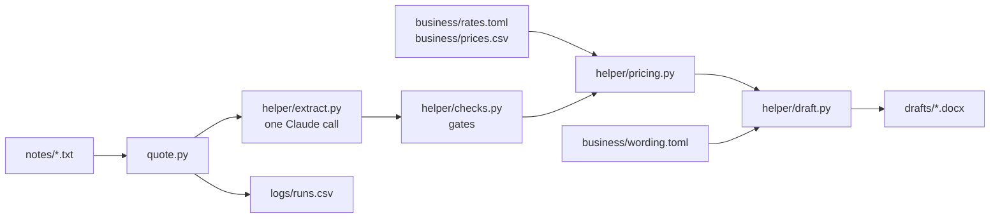
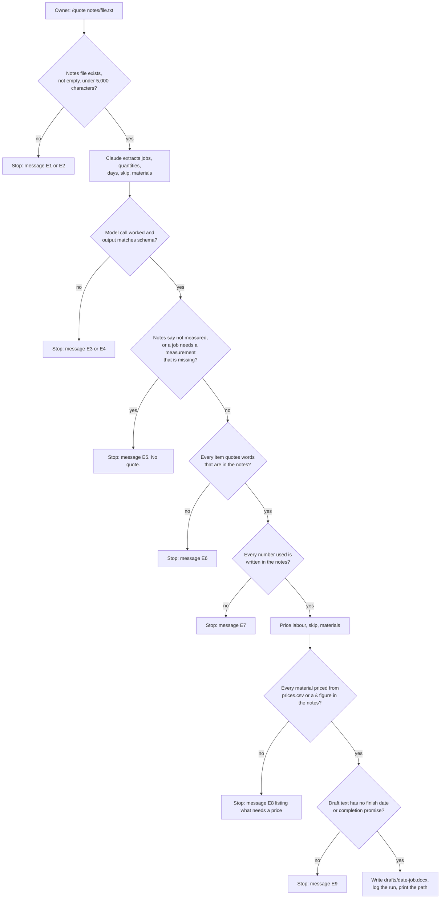

# Design: Quote helper

<!--
HOW TO USE THIS FILE
1. Read Part 1 and correct it in your own words. Your words win.
2. Optional: "Turn DESIGN.md into an artifact I can share."
3. Build one step at a time: /next-step

AGENT: keep these headings. Part 1 is plain British English for an owner who
does not code. Part 2 is for the agent that builds it: exact, complete,
testable. Never put real client names, personal data or secrets in this file.
-->

> Two parts for two readers. **Part 1** is for the owner, in plain words. **Part 2** is for the agent that builds it.

---

# Part 1. For the owner: the plain brief

Read this part, correct anything wrong, and say yes or change it. Nothing is built until you are happy with it.

## 1. What it is for
- **The problem, in one or two sentences:** After a site visit I type rough notes on my phone in the van. Turning them into a proper quote in Word takes me about an hour each time.
- **Who uses it:** Just me.
- **What they get:** A draft quote in Word, laid out the way I always do it, with the sums done, ready for me to check, save as a PDF and email myself.
- **What it does not do:** It never sends anything to the client. It never makes up a price or a measurement. Pricing judgement and the final check stay with me.

## 2. How it will be used
1. I copy my site visit notes from my phone into a note file on the Mac **(to confirm: how the notes get from the phone to the Mac, for example AirDrop, Notes sync or email to myself)**.
2. I type `/quote` and the name of the note file in Claude Code.
3. The helper reads the notes and picks out the jobs, the measurements, the days for me and my labourer, the skip and the materials. It only uses what I wrote.
4. It prices labour and the skip from my rates, and materials from my price list or from a figure I wrote in the notes.
5. It checks itself. If something is missing (no measurement, a material with no price, a job not measured yet) it does not make a quote. It tells me in one plain sentence what is missing.
6. If all is well, I get a Word file in the `drafts` folder. I read it, change anything I want, save it as a PDF and email it myself.

**One worked example (made up):** "Garden wall rebuild 6m long 1m high, brick, 3 days me + labourer 3 days, materials about £600" gives a short friendly quote: what we will do in plain words, then a table with materials £600, labour (3 days me at £280, 3 days labourer at £180) £1,380, subtotal £1,980, VAT, total, then the usual terms.

## 3. Your business, in your words
Drafted from your answers. Correct every line.

| Question | Why it matters | Answer |
|---|---|---|
| Who are your customers or readers? | So it judges work for real people | Mostly homeowners, a few landlords. |
| What do they ask you most often? | These are the jobs worth doing first | Bathrooms, kitchens and garden walls **(to confirm: what else comes up most)**. |
| What does a good result look like? | So it knows when it is done | Short and friendly. What we will do in plain words, then a table: materials, labour, extras like skip hire. Subtotal, VAT at 20%, total. Start date "subject to availability", rough duration, 30% deposit, rest on completion, price valid 30 days. Sent as a PDF by email. |
| What must it never do or say? | Becomes a rule, and a test | Never send it to the client itself. Never invent a price or a measurement. Never promise a finish date. Never quote for anything I did not write in the notes. |
| What must it never touch? | Files, systems, money, people | My email and my clients. It only writes draft files on my Mac. |
| Your words: tone, terms, categories | So the output sounds like you | Plain and friendly. Lines are Materials, Labour and Extras. "Subject to availability" for the start date. |
| Your prices | So it never guesses a price | Day rate £280 for me, £180 for my labourer. Skip £320. Materials from my rough spreadsheet list, saved into the helper as a price list **(to confirm: you will export it, and update it when prices change)**. |
| Busy times or deadlines in your year | So it plans around them | None needed for this helper **(to confirm)**. |
| What is private here? | So private data stays out | Client names, addresses and phone numbers. Real notes and drafts stay on my Mac and never go into the code, the tests or GitHub. |
| Three examples where you know the right answer | These become the tests it must pass | 1. Bathroom: strip out old suite, client supplies new suite, retile walls 12m², new floor 4m², 4 days me, labourer 2 days, skip. Quote £2,926 + VAT. 2. Garden wall rebuild 6m long, 1m high, brick, 3 days me, labourer 3 days, materials about £600. Quote £2,000 + VAT. 3. Kitchen, "just wants a rough idea, not measured yet". No quote: it must say I need to measure first. |

Things I need you to check in those examples:
- **Bathroom:** labour comes to £1,480 (4 days at £280 and 2 days at £180) and the skip is £320. That leaves £1,126 for tiles, adhesive, grout and the floor. Is that right, and which items on your price list make it up? **(to confirm)**
- **Garden wall:** my sums come to £1,980, not £2,000. Did you round up, or is there a £20 line I am missing (sand, cement, sundries)? **(to confirm)**
- **Deposit:** is the 30% taken on the total with VAT? On the bathroom that would be £1,053.36. **(to confirm)**
- **Duration:** should it use the days in your notes, for example "about 4 working days"? **(to confirm)**

## 4. Promises built into it
- It never sends, emails or shares a quote. It has no way to: there is no email code in it at all.
- It never invents a price. Every price comes from your rates, your price list or a figure you wrote in the notes. This is checked in code.
- It never invents a measurement. Every measurement and every number of days in the quote must appear in your notes. This is checked in code.
- It never quotes for a job you did not write down. Every line must point back to words in your notes. This is checked in code.
- It never promises a finish date. The start date always says "subject to availability", and the helper refuses a draft that names a finish date.
- If a job has not been measured, it makes no quote and says you need to measure first.
- It never sees your passwords or keys.

## 5. Your decisions
1. Say yes to this brief, or change it.
2. Check every draft before it goes to a client. You send it, never the helper.
3. Approve each change to the helper yourself (on GitHub: press Merge).
4. When a draft is wrong, say so. It becomes a new test.

## 6. Finished means
- 3 of 3 of your examples give the right answer (the right total, or "measure first").
- 0 made up prices, measurements or jobs.
- A draft is ready in under a minute, instead of an hour.
- You can change your rates, your price list and your wording yourself, in plain files.

---

# Part 2. For the agent: the build spec

Agent: Part 1 is the requirements. Build exactly what this part says, in this order. Stop and ask when anything here is unclear, risky or costs money.

## Pieces


- `quote.py`: the one command. Reads a notes file, runs the pieces in order, prints one plain line for the owner. Writes `drafts/` and `logs/`.
- `helper/extract.py`: one Claude API call. Reads the notes text. Returns the fixed `Extraction` schema. Never sees or returns prices from the price list.
- `helper/schema.py`: the `Extraction`, `Item` and `Quote` dataclasses and the JSON schema sent to the model.
- `helper/checks.py`: every gate in the flow below. Pure functions, no network. Reads the notes text and the extraction.
- `helper/pricing.py`: turns the extraction into priced lines and totals using `business/rates.toml` and `business/prices.csv`. Pure arithmetic in pence (integers). No model.
- `helper/draft.py`: writes the Word draft with `python-docx` from the priced quote and `business/wording.toml`.
- `business/`: the owner's own files, plain text they can edit.
- No database, no server, no hosting, no email. It runs on the owner's Mac because they are the only user and already send the PDF themselves.

## Flow: one run, start to finish

Gates G3 to G7 are code, not prompt. The prompt also asks for the same behaviour, but the code decides.

## Contract
**Command:** `python3 quote.py <notes-file>`, wrapped by the `/quote` skill. Exit code 0 with a draft, 1 with a plain message and no draft.

**Core function:** `make_quote(notes_text: str, extractor: Extractor) -> QuoteResult`. `Extractor` is an interface with a real Claude version and a fake version that returns saved JSON, so every test except the live run is free.

**Inputs**
| Input | Source | Limits |
|---|---|---|
| Notes text | `notes/*.txt`, typed by the owner | UTF-8, 1 to 5,000 characters. Treated as data, never as instructions. |
| Rates | `business/rates.toml` | `owner_day_pence = 28000`, `labourer_day_pence = 18000`, `skip_pence = 32000`, `vat_rate = 0.20`, `deposit_rate = 0.30`, `valid_days = 30` |
| Price list | `business/prices.csv` | Columns `item,unit,price_pence,aliases`. Unit is one of `m2`, `m`, `each`, `job`. |
| Wording | `business/wording.toml` | Greeting, sign off, business name and contact, terms lines. Fixed text, never written by the model. |

**Model output: `Extraction` (structured output, fixed schema, `additionalProperties: false`)**
| Field | Type | Rule that checks it |
|---|---|---|
| `job_title` | string, max 60 chars | Words must appear in the notes (G4). |
| `ready_to_price` | bool | False if the notes say not measured, rough idea, or similar. False forces E5 (G3). |
| `not_ready_reason` | string or null | Required when `ready_to_price` is false. |
| `items[]` | list of `Item` | At least one when ready. |
| `Item.description` | string, plain words | Shown to the client. Checked for dates and finish promises (G7). |
| `Item.source_quote` | string | Exact substring of the notes, case and spacing normalised (G4). |
| `Item.kind` | `labour_owner`, `labourer`, `skip`, `material`, `work` | `work` lines carry no price, they describe the job. |
| `Item.quantity` | number or null | If set, the number must appear in the notes (G5). |
| `Item.unit` | `day`, `m2`, `m`, `each`, `job` or null | Must match the price list unit for materials. |
| `Item.notes_price_pence` | int or null | Only when the notes contain that £ figure, for example "materials about £600" (G5, G6). |
| `Item.client_supplies` | bool | True when the notes say the client supplies it. Shown as "supplied by you", priced at 0. |
| `duration_days` | number or null | Taken from the owner's days in the notes. Must appear in the notes (G5). |

**Priced `Quote`:** lines grouped as Materials, Labour, Extras; `subtotal_pence`, `vat_pence` (round half up to the penny), `total_pence`, `deposit_pence` (30% of the total with VAT, **pending owner confirmation**), start line "Start date: subject to availability", duration line "About N working days", payment line, validity line.

**Errors**
| Code | Cause | Caught in | Message the owner sees |
|---|---|---|---|
| E1 | File missing | `quote.py` | "I could not find that notes file. Check the name and try again." |
| E2 | Empty or over 5,000 characters | `checks.py` | "The notes are empty or too long. Keep one job per file." |
| E3 | API down, timeout, no key, refusal | `extract.py` | "The AI service did not answer. Nothing was made. Try again in a few minutes." |
| E4 | Output fails the schema | `extract.py` | "The reading of your notes came back garbled. Nothing was made. Try again." |
| E5 | Not measured or missing measurement | `checks.py` | "No quote made: [job] needs measuring first." |
| E6 | An item not found in the notes | `checks.py` | "No quote made: I found a line that is not in your notes ([line]). Please check the notes." |
| E7 | A number not in the notes | `checks.py` | "No quote made: the number [n] is not in your notes." |
| E8 | Material with no price | `pricing.py` | "No quote made: these need a price in your price list or your notes: [items]." |
| E9 | Finish date or completion promise found | `checks.py` | "No quote made: the draft mentioned a finish date, which you never promise." |

## Decisions
| Choice | Why | When to think again |
|---|---|---|
| Claude Opus 5.5 (`claude-opus-5-5`), effort `low`, adaptive thinking, structured output, server side fallbacks on | Reading rough van notes reliably matters more than speed; the job is small so low effort is enough. Prices and sums are done in code, so the model only reads. | If the examples pass on Claude Haiku 5.5 (`claude-haiku-5-5`) and the owner wants it cheaper, try it on the examples first. |
| Full notes text in one request, no caching | Notes are short. The system prompt is under the size where caching pays. | If a price list or long wording is ever sent to the model. |
| Prices and arithmetic in Python, in pence | The model must never set a price. Integers avoid rounding errors. | Never. |
| Word draft (`.docx`), not PDF | The owner already edits in Word and saves as PDF. They can fix anything before sending. **(to confirm)** | If they want a finished PDF straight away. |
| Runs on the owner's Mac, started from Claude Code with `/quote` | One user, no hosting, no password, notes stay on their machine. | If they want to make quotes from their phone in the van. Then a small private web page with a password. |
| Python 3, `anthropic`, `python-docx`, `pytest` | Python comes with the Mac developer tools; the hook already uses it. | Never for this size. |

## Folder
```
quote-helper/
  CLAUDE.md                     project memory and rules
  DESIGN.md                     this file
  README.md                     how to start, for the owner
  .env.example                  lists ANTHROPIC_API_KEY with no value
  .gitignore                    keeps .env, notes/, drafts/, logs/ out of git
  requirements.txt              anthropic, python-docx, pytest
  quote.py                      the one command
  helper/
    __init__.py
    schema.py                   Extraction, Item, Quote, JSON schema
    extract.py                  ClaudeExtractor and FakeExtractor
    prompt.md                   the system prompt for extraction
    checks.py                   gates G1 to G7
    pricing.py                  priced lines and totals in pence
    draft.py                    writes the .docx
  business/
    rates.toml                  day rates, skip, VAT, deposit, validity
    prices.csv                  materials price list, from the owner's spreadsheet
    wording.toml                greeting, terms, sign off, business details
  notes/                        real site notes (not in git)
  drafts/                       finished drafts (not in git)
  logs/
    runs.csv                    date, file, result, tokens, cost (not in git)
  tests/
    examples/
      a-bathroom.txt            made up notes, example 1
      a-bathroom.expected.json  expected lines and £2,926 subtotal
      b-garden-wall.txt
      b-garden-wall.expected.json
      c-kitchen.txt
      c-kitchen.expected.json   expected E5, no draft
    fake_extractions/           saved model output for each example
    test_pricing.py             sums, VAT, deposit, rounding
    test_checks.py              each gate passes and fails
    test_promises.py            one test per promise in Part 1, section 4
    test_examples.py            the three examples end to end with the fake
    test_live.py                the three examples with the real model, run only with --live
  .claude/
    settings.json               deny rules and hooks
    hooks/protect-secrets.py    blocks tool calls that touch .env
    agents/reviewer.md          read only reviewer
    skills/
      design/SKILL.md
      next-step/SKILL.md
      check-examples/SKILL.md
      explain-it/SKILL.md
      ship-check/SKILL.md
      quote/SKILL.md            /quote <notes file>: runs quote.py and reports the result
```

## Settings
| Layer | Setting | Value | Why |
|---|---|---|---|
| Building (Claude Code) | Deny reading or editing `.env` | `.claude/settings.json` | Agent never sees secrets |
| Building | Deny deploying to live and pushing to main | `.claude/settings.json` | Only the owner ships |
| Building | Hook: block any tool call that mentions `.env` | `.claude/hooks/` | Second lock |
| Running | Model, effort, max output | `claude-opus-5-5`, effort `low`, `max_tokens` 8000, timeout 60 s, 2 retries | Small extraction, fails fast |
| Running | Fallback on refusal | `fallbacks: "default"` with beta `server-side-fallback-2026-07-01` | A refusal gives E3, not a crash |
| Running | Input limits | 5,000 characters per notes file, one call per run | Keeps cost and mistakes small |
| Running | No network apart from the Anthropic API | `test_promises.py` checks no `smtplib`, `requests`, email or upload code exists | Promise: never sends |
| Secrets | `ANTHROPIC_API_KEY` | `.env` on the Mac, typed by the owner | Typed by the owner only |

**Skills and agents**
| Name | When | May touch |
|---|---|---|
| `/quote` | Each new quote | Reads `notes/`, runs `quote.py`, writes `drafts/` and `logs/` |
| `/design` | Changing the design | `DESIGN.md`, `CLAUDE.md` |
| `/next-step` | Building | Project files, git on a branch |
| `/check-examples` | After any change | Runs tests; asks before `--live` |
| `/explain-it` | Any time | Reads only |
| `/ship-check` | Before first real use | Reads, runs tests |
| `reviewer` | Before merging | Reads, runs free tests |

## Build with subagents
Not needed. The work is small and every file depends on the schema. Build in order with `/next-step`. Use the `reviewer` agent at the end.

## Build steps
- [ ] 1. Set up: branch `build`, `requirements.txt`, empty package, `.gitignore` adds `notes/`, `drafts/`, `logs/`; `.env.example` lists `ANTHROPIC_API_KEY`: `pytest` runs with 0 tests and `git status` shows no notes or drafts.
- [ ] 2. Business files: `rates.toml` with the owner's rates, `wording.toml` from Part 1, `prices.csv` with made up rows until the owner exports their list: a test loads all three and checks £280, £180, £320, 20%, 30%, 30 days.
- [ ] 3. Schema: `schema.py` with dataclasses and the JSON schema: a test validates the three saved fake extractions and rejects one with an extra field.
- [ ] 4. Pricing: `pricing.py`: tests give the garden wall £1,980 from its fake extraction (or £2,000 once the owner confirms the rule), VAT and deposit to the penny, and a client supplied suite at £0.
- [ ] 5. Gates: `checks.py`, G1 to G7: `test_checks.py` has a pass and a fail for each gate, including a made up measurement, a line not in the notes, a material with no price and a finish date.
- [ ] 6. Draft: `draft.py` writes the Word file from the garden wall quote: a test opens the file and finds the plain description, the table lines, the totals and "subject to availability".
- [ ] 7. Command: `quote.py` with `FakeExtractor`: `test_examples.py` runs all three examples; bathroom and wall make drafts with the expected subtotals, kitchen gives E5 and no file.
- [ ] 8. Promises: `test_promises.py`, one test per line of Part 1, section 4: all pass.
- [ ] 9. Real extractor: `extract.py` with `prompt.md` and the Claude call, logging tokens and cost to `logs/runs.csv`. Ask the owner first: three calls, a few pence in total. Test: `pytest --live` on the three examples gives the same results as the fake.
- [ ] 10. `/quote` skill and README section: the owner runs `/quote` on a made up note and opens the draft in Word.
- [ ] 11. Review: run the `reviewer` agent and `/ship-check`: findings fixed or explained.

## Definition of done
| Check | How to prove it |
|---|---|
| Every example in Part 1, section 3 passes | `pytest tests/test_examples.py` and once `pytest tests/test_live.py --live` |
| Every promise in Part 1, section 4 holds | `pytest tests/test_promises.py tests/test_checks.py` |
| No secret in git | `.env` ignored, `git diff main` checked for keys |
| No client data in git | `notes/`, `drafts/`, `logs/` ignored; examples use made up names |
| Reviewed | reviewer findings fixed or explained |

## GitHub
Work on the `build` branch, one commit per build step with a plain message. Open a pull request with a plain English summary. There is no preview link because nothing is hosted; the owner tries `/quote` on a made up note instead. The owner merges. To undo a bad change, revert the merge commit on GitHub or ask Claude to go back to the last checkpoint.

## Deploy
Nothing is deployed. It runs on the owner's Mac. The owner types their `ANTHROPIC_API_KEY` into `.env` and sets a monthly spend limit in the Anthropic Console. They update `business/prices.csv` when material prices change.

## Keep it working
| When | What | How |
|---|---|---|
| Material prices change | Update the price list | Edit `business/prices.csv` or re-export from the spreadsheet |
| Rates change | Update rates | Edit `business/rates.toml`, then `/check-examples` |
| A draft is wrong | Add it as a test | Tell Claude; it adds made up notes and the right answer to `tests/examples/` |
| The model is retired | Move to the current one | `/check-examples` with `--live` before and after |

## Monitor
From `logs/runs.csv`: cost per run, how many runs stopped and why (E1 to E9), and how often the "measure first" or "needs a price" gates fired. `/explain-it` can summarise it.

## Cost
One run is one Claude call: about 2,000 tokens in and up to 3,000 out. At Claude Opus 5.5 prices ($4 per million in, $20 per million out, checked November 2026) that is about 7 cents a quote. Claude Haiku 5.5 ($0.10 and $0.50) would be well under 1 cent. Building costs nothing extra apart from Claude Code use and the three live test calls. Cap: the monthly spend limit the owner sets in the Anthropic Console.

## Hand over
The owner opens the folder in Claude Code and types `/quote notes/<file>.txt`. To change wording or rates they edit the files in `business/` or asks Claude in plain English. When a draft is wrong they say so and it becomes a new test. Next to build, if they want it: making quotes from their phone.
